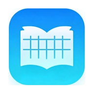

# Mimi 课表

<p align="center">
  
</p>

武夷学院课程安排与成绩查询工具。

把教务系统里散落的课表和分数，收进一个能随手打开的地方。

## 下载安装

**[下载 mimi-kebiao-3.2.apk](https://github.com/Aokiisei/-Mimi-/releases/tag/v3.2)** （9.6 MB，Android 7.0+）

下载后传到手机上点开安装即可。若提示「禁止安装未知来源应用」，去系统设置里允许浏览器/文件管理器安装即可。

> 历史版本与更新日志见 [Releases](https://github.com/Aokiisei/-Mimi-/releases) 页面。

## 功能

- **课程表** —— 按周次查看当日课程，支持周次切换与全屏查看
- **成绩查询** —— 分学期拉取成绩，查看已修课程与分数
- **桌面小组件** —— 主屏直接看当天课程，不用打开应用
- **公交查询** —— 查询公交线路与到站信息，方便校园出行
- **智能助手** —— 内置助手页，提供答疑与快捷操作入口
- **日程管理** —— 查看与管理个人日程安排
- **暖纸主题** —— 新增暖色调纸质视觉风格
- **公告与更新** —— 启动时拉取公告，检测新版本
- **崩溃日志上报** —— 异常时记录日志，可一键反馈

## 技术栈

| 项 | 值 |
| :-- | :-- |
| 语言 | Java |
| 应用 ID | `com.mimi.kebiao`（源码包 `com.wuyi.kebiao`） |
| 最低版本 | Android 7.0（API 21） |
| 目标版本 | Android 14（API 34） |
| 当前版本 | 3.2（versionCode 20） |

课程表与成绩页面通过 WebView 承载教务系统（`jwxt.wuyiu.edu.cn`），Java 层负责登录态维持、会话超时判断、数据缓存与桌面小组件刷新。

## 构建

```bash
cp keystore.properties.example keystore.properties   # 填入密钥库路径与密码（不会被提交）
echo "sdk.dir=/your/path/to/Android/sdk" > local.properties
./gradlew assembleRelease                            # Windows 用 gradlew.bat
```

也可以直接用 Android Studio 打开工程根目录构建。

> 仓库已内置 Gradle Wrapper（Gradle 8.9，适配 AGP 8.5.2），首次构建会自动下载 Gradle，
> 国内网络已配置腾讯镜像加速；内置的 `android-sdk/`（约 437M）未入库，需自行安装 Android SDK 并配置 `local.properties`。

## 源码结构

```
app/src/main/
├── java/com/wuyi/kebiao/     # 见下方文件说明
├── res/                      # 界面布局、图标、主题
└── assets/www/
    ├── index.html            # 课表页面（注入教务系统后由前端解析渲染）
    ├── grade.html            # 成绩页面
    ├── bus.html              # 公交查询页面
    └── schedule.html         # 日程页面
```

### 界面

| 文件 | 作用 |
| :-- | :-- |
| `MainActivity.java` | 主界面。安装崩溃处理器、初始化主题、绑定底部导航与页面容器，并触发自动更新检查 |
| `SplashActivity.java` | 启动页，展示 500ms 后跳转主界面 |
| `HomeFragment.java` | **核心页面**。用 WebView 承载教务系统，注入 JS 抓取课表与成绩，负责登录态、会话超时判定与数据缓存 |
| `GradeFragment.java` | 成绩页。继承 `HomeFragment`，仅切换为成绩模式 |
| `ProfileFragment.java` | 「我的」页面：公告、版本更新、意见反馈、打赏入口 |

### 主题与视觉

| 文件 | 作用 |
| :-- | :-- |
| `ThemeH.java` | 主题工具：读写主题偏好、状态栏与底部导航着色、液态玻璃样式套用 |
| `GlassBgAnim.java` | 液态玻璃背景动画，循环插值生成渐变背景 |
| `GlassSwitchListener.java` | 「液态玻璃效果」开关，保存开关状态 |

### 网络与服务器交互

| 文件 | 作用 |
| :-- | :-- |
| `AnnouncementFetcher.java` | 后台拉取服务器公告，取不到时给出兜底文案 |
| `ConnectionTester.java` | 测试教务系统是否可连通，结果 Toast 提示 |
| `FeedbackSender.java` | 把用户反馈提交到服务器（附带机型与系统版本） |
| `UpdateChecker.java` | 检查新版本、弹出更新提示、下载 APK 并引导安装 |

### 稳定性

| 文件 | 作用 |
| :-- | :-- |
| `CrashHandler.java` | 全局未捕获异常处理器，崩溃时写日志后交还系统 |
| `CrashLogger.java` | 日志工具，同时写 Logcat 与本地 `mimi_crash.log` |

### 交互回调

以下类均为**主线程回调封装**——后台线程拿到数据后，通过它们切回主线程再更新界面，避免子线程直接操作 UI：

| 文件 | 作用 |
| :-- | :-- |
| `AnnouncementShowRunnable.java` | 把公告文本交给「我的」页显示 |
| `GradeNotifyRunnable.java` | 把成绩数据传回课表页 |
| `GradeTermsRunnable.java` | 把可选学期列表传回课表页 |
| `GradeLogRunnable.java` | 把成绩抓取日志传回课表页 |
| `TimetableLogRunnable.java` | 把课表抓取日志传回课表页 |
| `ForwardMsgRunnable.java` | 向 WebView 注入数据（调用页面 `window.receiveFromAndroid`） |
| `InjectGradeRunnable.java` | 触发课表页注入成绩解析脚本 |
| `StartGradeRunnable.java` | 触发开始抓取成绩 |
| `StartLoadRunnable.java` | 触发加载爬虫入口页 |
| `FeedbackSubmitListener.java` | 反馈对话框的提交按钮 |
| `ConnectionTestClickListener.java` | 「测试连接」的点击入口 |
| `MoreClickListener.java` | 「更多」对话框（玻璃开关、测试连接、使用说明） |
| `UsageGuideClickListener.java` | 弹出「使用说明」对话框 |

### 桌面小组件

| 文件 | 作用 |
| :-- | :-- |
| `widget/CourseWidgetProvider.java` | 小组件生命周期入口，收到系统更新时触发重绘 |
| `widget/CourseWidgetService.java` | 读取已缓存的课表数据，按当天过滤并渲染小组件内容 |

## 开源协议

本项目以 **Apache License, Version 2.0** 发布。

- 许可证全文见仓库根目录的 [LICENSE](LICENSE) 文件。
- 第三方组件的版权与署名见 [NOTICE](NOTICE) 文件（AndroidX、Material、Gson、OkHttp 等均为 Apache 2.0）。
- 在遵守本许可证的前提下，你可以自由地使用、修改、分发本项目的代码。
