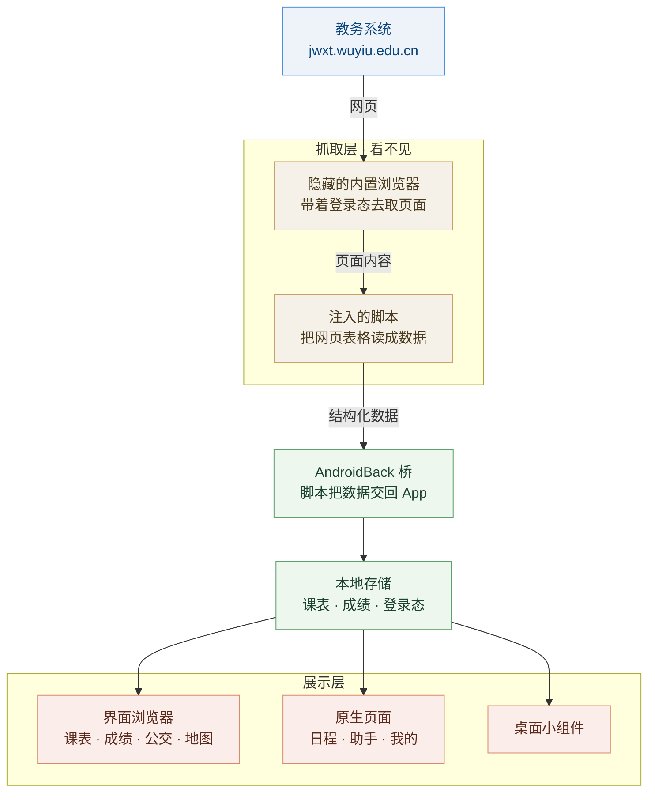
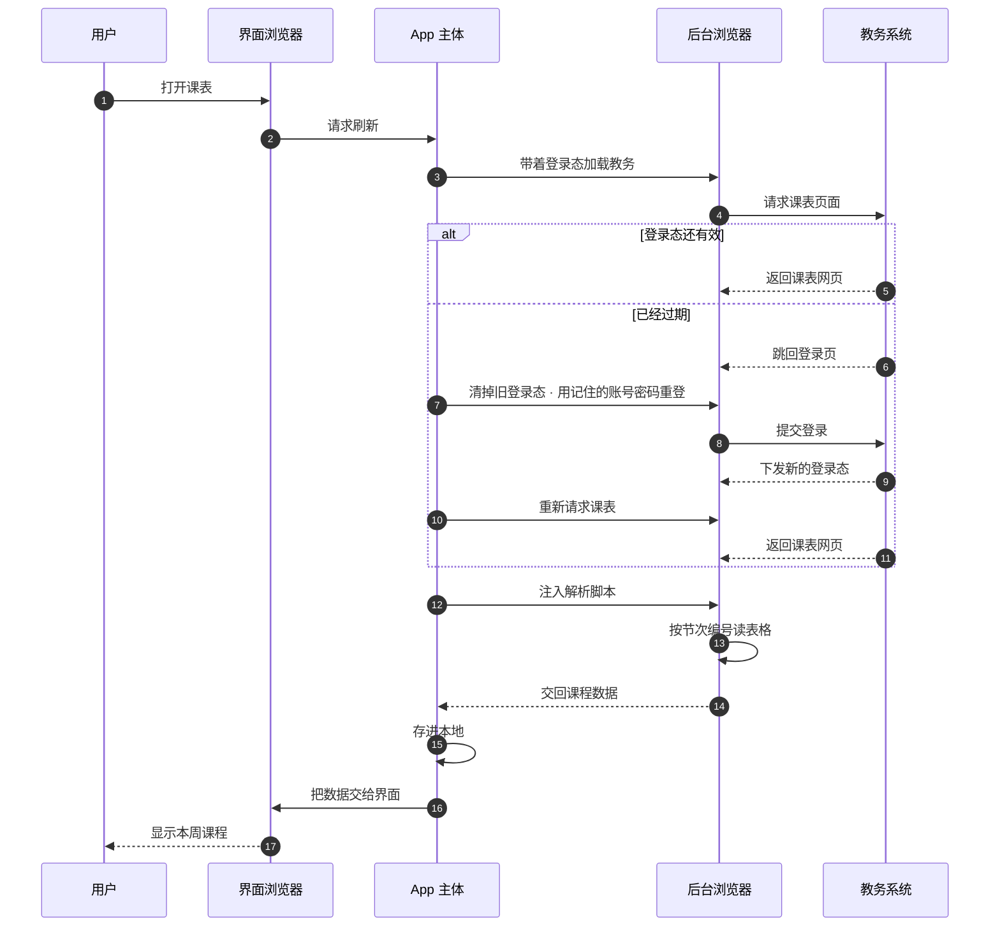
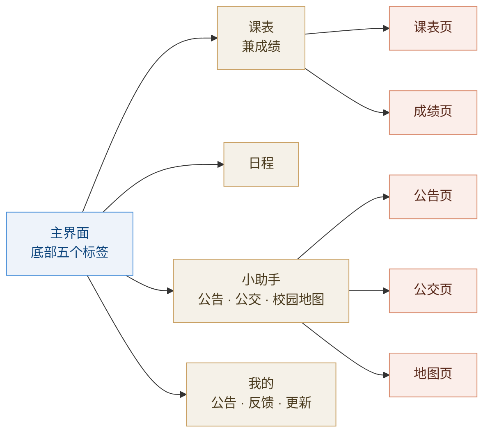

<p align="center">
  
</p>

<h1 align="center">Mimi 课表</h1>

<p align="center">
  武夷学院课程安排与成绩查询工具<br/>
  把教务系统里散落的课表和分数，收进一个能随手打开的地方
</p>

<p align="center">
  <a href="https://github.com/Aokiisei/-Mimi-/releases/latest"></a>
  
  
</p>

<p align="center">
  
  
  
  
</p>

## 下载安装

点上面的 **下载 APK** 按钮，或打开 [Releases](https://github.com/Aokiisei/-Mimi-/releases) 挑版本；传到手机上点开安装即可。

若提示「禁止安装未知来源应用」，去系统设置里允许浏览器 / 文件管理器安装。

> 需要 **Android 5.0** 及以上（API 21）。每个版本都带独立安装包，v3.1 起的版本另有完整源码。

**使用前提**：仅适用于**武夷学院**，登录需要本人的教务系统账号（学号 + 密码）。其他学校的教务系统结构不同，用不了。

## 功能

**课表**

- 按周次查看当日课程，支持「全部周次」与全屏
- 全屏一屏完整显示 7 天 × 6 节次，无需横向滚动
- 第九至十二节全部支持，晚课卡片标注「晚七 / 晚九」
- 跨格日程框：有课时透明透出，整段无课才实底展开详情

**成绩**

- 分学期拉取，可展开每门课的成绩构成
- 教务首页是异步加载的，登录后自动延时复检一次，避免只抓到前几门

**校园生活**

- **校园公告** —— 汇总学校官网与 13 个二级学院公告，可按来源筛选、查看正文与图片
- **公交查询** —— 武夷山公交线路与到站信息
- **校园地图标注** —— 填入自备的高德 Key，同学共同标注校园地点，支持搜索、举报与一键导航
- **日程管理** —— 倒计日、单点提醒，卡片右滑标记完成

**体验**

- **上课提醒** —— 课前 10 分钟提醒课程名、时间与地点；每晚 22:00 汇总明日课表；两类提醒可分别开关，重启或改时间后自动恢复
- **桌面小组件** —— 主屏直接看当天课程，按当前教学周过滤，同一时段只留一条
- **暖纸主题** —— 暖色调纸质视觉，全 App 统一衬线字体
- **公告与更新** —— 启动拉取公告，检测新版本
- **崩溃日志上报** —— 异常记录日志，可一键反馈

## 技术栈

| 项 | 值 |
| :-- | :-- |
| 语言 | Java（源码级别 1.8，用 JDK 17 构建） |
| 应用 ID | `com.mimi.kebiao`（源码包 `com.wuyi.kebiao`） |
| 最低 / 目标版本 | Android 5.0（API 21）/ Android 14（API 34） |
| 构建 | AGP 8.5.2 · Gradle 8.9 · JDK 17 |
| 当前版本 | 3.4（versionCode 29） |
| 核心依赖 | AppCompat 1.6.1 · Material 1.11.0 · Navigation 2.7.7 · OkHttp 4.12.0 · Gson 2.10.1 |

登录与取数都由 WebView 走教务系统本身完成（`AndroidBack.login()` 提交，`CookieManager` 维持登录状态）。更新检查与 APK 下载走 OkHttp，公告和反馈走 `HttpURLConnection`——都不碰教务的请求。

## 架构

教务系统没有开放接口，也没给 App 用的 API，所以整条链路是自己接的。

办法是用两个内置浏览器（WebView）分工：**一个藏在后台专门加载教务页面**，负责"进去把东西拿出来"；**另一个负责界面**，只管显示。抓回来的网页不直接展示，而是往里注入一段脚本，把表格读成数据，再交回 App 存起来，最后推给界面。

教务那边看到的始终是一次正常的浏览器访问，不需要破解任何加密。



这张图可以分三层看：

1. **去哪儿取** —— 教务系统，本质上就是一个普通网页
2. **怎么取** —— 后台那个看不见的浏览器加载它，注入的脚本在页面里把表格解析成数据
3. **放在哪、给谁看** —— 数据存进本地，界面和桌面小组件都从本地读，不用每次都联网

下面是一次课表刷新的完整过程。

这里最容易出问题的是**登录态过期**：服务器会悄悄把人送回登录页，界面上看起来就是一张空课表，什么提示都没有。所以做了主动判断和自动续期。



解析规则单独存成 `timetable_parser.js`，而不是写死在 Java 字符串里——这套规则经常要改，独立成文件才好在浏览器里调试。晚课（第 9–12 节）的归属判定就靠它：先看节次编号，没有再找行标题里的数字，最后才按位置兜底。

## 功能模块

App 底部有五个标签，各自对应一个页面：



## 构建

需要 **JDK 17** 和 **Android SDK 34**（含 build-tools）。路径按自己的机器改，`local.properties` 与 `keystore.properties` 都不会被提交。

```bash
cp keystore.properties.example keystore.properties   # 填入密钥库路径与密码
echo "sdk.dir=/your/path/to/Android/sdk" > local.properties
./gradlew assembleRelease                            # Windows 用 gradlew.bat
```

也可以直接用 Android Studio 打开工程根目录构建。

> 仓库已内置 Gradle Wrapper（Gradle 8.9，适配 AGP 8.5.2），首次构建会自动下载 Gradle，
> 国内网络已配置腾讯镜像加速；内置的 `android-sdk/`（约 437M）未入库，需自行安装 Android SDK 并配置 `local.properties`。

## 源码结构

```
app/src/main/
├── java/com/wuyi/kebiao/     # 见下方文件说明
├── res/                      # 界面布局、图标、主题
└── assets/www/
    ├── index.html            # 课表页面（注入教务系统后由前端解析渲染）
    ├── grade.html            # 成绩页面
    ├── notice.html           # 校园公告页面（列表 / 详情 / 图片预览）
    ├── bus.html              # 公交查询页面
    ├── map.html              # 校园地图标注页面（高德 JS API）
    ├── schedule.html         # 日程页面
    ├── timetable_parser.js   # 课表解析脚本，注入教务页面执行
    ├── wheel.css             # 时间选择滚轮样式（课表页与日程页共用）
    └── wheel.js              # 时间选择滚轮逻辑，不依赖 CSS scroll-snap
```

### 界面

| 文件 | 作用 |
| :-- | :-- |
| `MainActivity.java` | 主界面。安装崩溃处理器、初始化主题、绑定底部导航与页面容器，并触发自动更新检查 |
| `SplashActivity.java` | 启动页，展示 500ms 后跳转主界面 |
| `HomeFragment.java` | **核心页面**。用 WebView 承载教务系统，注入 JS 抓取课表与成绩，负责登录状态、超时判定与数据缓存 |
| `GradeFragment.java` | 成绩页。继承 `HomeFragment`，仅切换为成绩模式 |
| `ScheduleFragment.java` | 日程页。倒计日与提醒的时间选择、卡片右滑标记完成 |
| `AssistantFragment.java` | 小助手页。校园公告、公交查询与校园地图入口；公告通过 `MimiBridge` 访问自家接口，地图管理高德 Key 与导航跳转 |
| `ProfileFragment.java` | 「我的」页面：公告、版本更新、意见反馈、打赏入口 |

### 日程与对话框

| 文件 | 作用 |
| :-- | :-- |
| `ScheduleStore.java` | 日程的本地存取与自动清理（永不 / 过期 7 天 / 30 天） |
| `ScheduleCleanupClickListener.java` | 清理过期日程的入口 |
| `MimiDialogBuilder.java` | 统一样式的自定义对话框 |
| `MimiSystemDialogBuilder.java` | 系统风格对话框，用于需要原生外观的场景 |
| `CarouselSwitchListener.java` | 首页轮播开关，保存用户偏好 |

### 主题与视觉

| 文件 | 作用 |
| :-- | :-- |
| `ThemeH.java` | 主题工具：读写主题偏好、状态栏与底部导航着色、液态玻璃样式套用 |
| `GlassBgAnim.java` | 液态玻璃背景动画，循环插值生成渐变背景 |
| `GlassSwitchListener.java` | 「液态玻璃效果」开关，保存开关状态 |

### 网络与服务器交互

| 文件 | 作用 |
| :-- | :-- |
| `AnnouncementFetcher.java` | 后台拉取服务器公告，取不到时给出兜底文案 |
| `ConnectionTester.java` | 测试教务系统是否可连通，结果 Toast 提示 |
| `FeedbackSender.java` | 把用户反馈提交到服务器（附带机型与系统版本） |
| `UpdateChecker.java` | 检查新版本、弹出更新提示、下载 APK 并引导安装 |

### 稳定性

| 文件 | 作用 |
| :-- | :-- |
| `CrashHandler.java` | 全局未捕获异常处理器，崩溃时写日志后交还系统 |
| `CrashLogger.java` | 日志工具，同时写 Logcat 与本地 `mimi_crash.log` |

### 交互回调

以下类均为**主线程回调封装**——后台线程拿到数据后，通过它们切回主线程再更新界面，避免子线程直接操作 UI：

| 文件 | 作用 |
| :-- | :-- |
| `AnnouncementShowRunnable.java` | 把公告文本交给「我的」页显示 |
| `GradeNotifyRunnable.java` | 把成绩数据传回课表页 |
| `GradeTermsRunnable.java` | 把可选学期列表传回课表页 |
| `GradeLogRunnable.java` | 把成绩抓取日志传回课表页 |
| `TimetableLogRunnable.java` | 把课表抓取日志传回课表页 |
| `ForwardMsgRunnable.java` | 向 WebView 注入数据（调用页面 `window.receiveFromAndroid`） |
| `InjectGradeRunnable.java` | 触发课表页注入成绩解析脚本 |
| `StartGradeRunnable.java` | 触发开始抓取成绩 |
| `StartLoadRunnable.java` | 触发加载爬虫入口页 |
| `FeedbackSubmitListener.java` | 反馈对话框的提交按钮 |
| `ConnectionTestClickListener.java` | 「测试连接」的点击入口 |
| `MoreClickListener.java` | 「更多」对话框（玻璃开关、测试连接、使用说明） |
| `UsageGuideClickListener.java` | 弹出「使用说明」对话框 |

### 桌面小组件

| 文件 | 作用 |
| :-- | :-- |
| `widget/CourseWidgetProvider.java` | 小组件生命周期入口，收到系统更新时触发重绘 |
| `widget/CourseWidgetService.java` | 读取已缓存的课表数据，按当前教学周过滤并渲染；同一时段的多条记录合并为一条 |

### 提醒

| 文件 | 作用 |
| :-- | :-- |
| `reminder/CourseReminderScheduler.java` | 课前 10 分钟提醒与每晚 22:00 明日课表的排程与通知展示 |
| `reminder/CourseReminderReceiver.java` | 广播接收器。收到闹钟后发通知；开机、改时间/时区、App 更新后重排提醒 |
| `reminder/CourseLiveStatus.java` | 灵动胶囊 / 流体云（测试）的实时课程状态通知，带倒计时与进度 |
| `NotificationSettingsClickListener.java` | 「更多 → 通知设置」对话框，两个提醒开关；Android 13+ 按需申请通知权限 |

## 隐私与免责

**账号只存在本机。** 学号和密码保存在应用的 SharedPreferences 里，用于下次免密登录教务系统，不会上传到任何服务器。卸载应用或「清空账号」后即被删除，换手机需要重新登录。

**反馈只发送你填的内容。** 提交意见反馈时上传的是反馈文本与机型信息，不含账号、课表或成绩。

**数据来自教务系统。** 课表与成绩取自武夷学院教务系统（`jwxt.wuyiu.edu.cn`）的页面内容，本应用只负责把它重新排版显示，不做二次分发。

**非官方应用。** 本项目为个人开发，与武夷学院官方无关。教务系统改版导致抓取失效属于正常情况，会在后续版本修复；遇到问题欢迎发邮件反馈。

## 开源协议

本项目以 **Apache License, Version 2.0** 发布。

- 许可证全文见仓库根目录的 [LICENSE](LICENSE) 文件。
- 第三方组件的版权与署名见 [NOTICE](NOTICE) 文件（AndroidX、Material、Gson、OkHttp 等均为 Apache 2.0）。
- 在遵守本许可证的前提下，你可以自由地使用、修改、分发本项目的代码。


